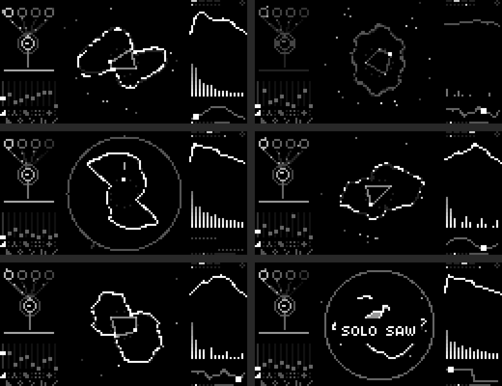
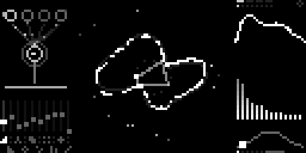
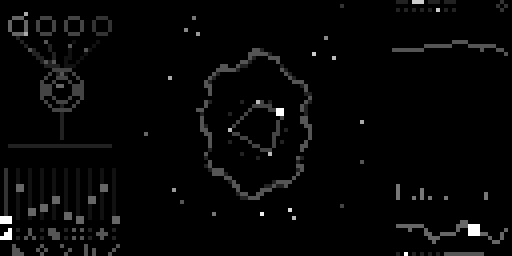
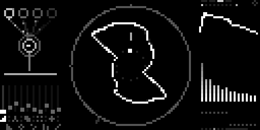
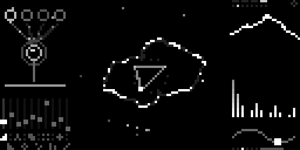
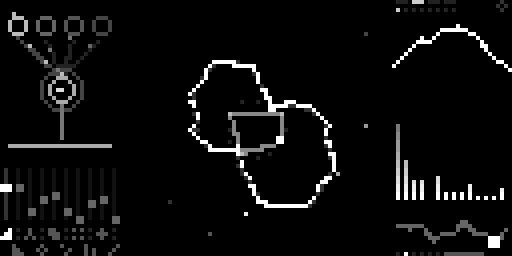
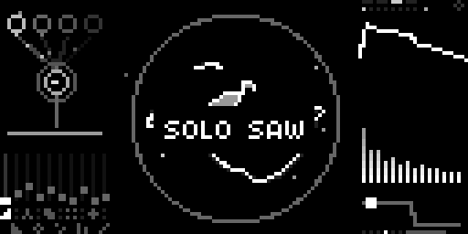

[English](README.md) · [Español](README.es.md) · **Français** · [Deutsch](README.de.md) · [日本語](README.ja.md) · [中文](README.zh.md) · [हिन्दी](README.hi.md)

# Chordex ABNT

Instrument d'accords pour pads, ambient, leads et textures sur
[monome norns](https://monome.org/docs/norns/). Une touche joue un accord de
quatre notes plus la basse à travers un moteur soustractif à 4 familles ×
8 presets, soit 32 sons. À la place d'un arpégiateur, il a le **MOUVEMENT** :
l'accord reste tenu et c'est le son qui change.



**L'écran est le son, calculé avec la même recette que celle qui joue :**

- **à gauche :** la voix. A (trois dents de scie désaccordées), B, SUB et
  AIRE (souffle) sont des cercles dont la luminosité est leur niveau ; ils
  envoient des particules vers le filtre. Le point dans le filtre est la
  fréquence de coupure, l'anneau la résonance, et le filtre oscille avec le
  LFO. En dessous, les 10 faders.
- **au centre :** la fleur, la vraie forme d'onde de la note dessinée en
  polaire. Fantôme = désaccord, duvet = souffle, coupures = grain, anneaux
  qui s'ouvrent = écho, étincelles = shimmer. Au milieu, l'accord sur la roue
  des 12 notes.
- **à droite :** famille et preset, oscilloscope, spectre et la courbe du
  mouvement parcourue par un point.

## Fonctions

- **4 familles × 8 presets**
  - **PAD** : warm pad, glass pad, cordes, chœur, sweep pad, dark pad, brass
    pad, poly années 80
  - **AMBIENT** : attaques longues, grande réverbération, écho et shimmer
  - **LEAD** : monophonique avec glide (priorité à la dernière note)
  - **TEXTURE** : grains, pluie, parasites, sable, insectes, glace, moteur,
    brume
- **voix** : trois VarSaw désaccordées (dent de scie → triangle), un
  oscillateur à impulsions à un intervalle choisi avec PWM, sub, souffle
  filtré, grains aléatoires, filtre résonant avec enveloppe et LFO propres,
  saturation, glide
- **MOUVEMENT** (K2), synchronisé au tempo, 6 modes :
  - **OLA** (vague) : le filtre monte et descend
  - **DERIVA** (dérive) : coupure, forme, désaccord et oscillateur B errent
    lentement au hasard
  - **RESPIRA** (respire) : chaque voix de l'accord monte, descend et bouge
    dans la stéréo, chacune à sa façon
  - **PULSO** (pulsation) : gate rythmique du volume (l'écho et la réverb
    continuent)
  - **GIRO** (rotation) : le son tourne dans la stéréo et le chorus s'ouvre
  - **MAREA** (marée) : le volume enfle et se retire ; la réverb grandit
    quand il baisse
  Chaque famille apporte son mode (PAD OLA, AMBIENT DERIVA, LEAD PULSO,
  TEXTURE RESPIRA)
- **effets** : chorus, écho ping-pong synchronisé, shimmer, réverbération
- **10 accords** : maj, min, dim, aug, 7, maj7, min7, m7b5, sus2, sus4
- panneau **strum**, **mode accord** on/off (off = jusqu'à 8 touches à la
  fois) et **maintien**
- suit l'horloge MIDI entrante pour le tempo du mouvement et de l'écho
- tous les réglages sont enregistrés automatiquement

<!-- u-ma:family -->
## La famille Chordex

Mêmes contrôles, moteurs différents. Essayez les autres :

| | |
|---|---|
| <a href="https://github.com/buenosairesfront/chordex80/blob/main/README.fr.md"></a> | **[Chordex 80](https://github.com/buenosairesfront/chordex80/blob/main/README.fr.md)**<br>polysynthé des années 80 avec un coucher de soleil outrun<br>`;install https://github.com/buenosairesfront/chordex80` |
| <a href="https://github.com/buenosairesfront/chordexfm/blob/main/README.fr.md"></a> | **[Chordex FM](https://github.com/buenosairesfront/chordexfm/blob/main/README.fr.md)**<br>FM à 4 opérateurs, dessinée comme une fleur<br>`;install https://github.com/buenosairesfront/chordexfm` |
| <a href="https://github.com/buenosairesfront/chordexstg/blob/main/README.fr.md"></a> | **[ChordexSTG](https://github.com/buenosairesfront/chordexstg/blob/main/README.fr.md)**<br>cordes d'orchestre avec le vrai mouvement d'une corde frottée<br>`;install https://github.com/buenosairesfront/chordexstg` |
| <a href="https://github.com/buenosairesfront/chordexwt/blob/main/README.fr.md"></a> | **[Chordex WT](https://github.com/buenosairesfront/chordexwt/blob/main/README.fr.md)**<br>wavetable : 8 banques de 8 ondes, dessinée comme une table en 3D<br>`;install https://github.com/buenosairesfront/chordexwt` |
| <a href="https://github.com/buenosairesfront/chordexchip/blob/main/README.fr.md"></a> | **[Chordex CHIP](https://github.com/buenosairesfront/chordexchip/blob/main/README.fr.md)**<br>chiptune : 8 puces de console × 8 presets, dessiné comme un tracker<br>`;install https://github.com/buenosairesfront/chordexchip` |

**Plus de U-MA :** tous les instruments et outils au même endroit → [vitrine U-MA](https://github.com/buenosairesfront/U-ma/blob/main/README.fr.md)
<!-- /u-ma:family -->

## Prérequis

- norns (shield, standard ou fates)
- un clavier ou contrôleur MIDI

## Installation

Depuis maiden :

```
;install https://github.com/buenosairesfront/chordexabnt
```

Puis **redémarrez norns** (SYSTEM > RESTART) pour compiler le nouveau moteur
`ChordexABNT`, et chargez **chordexabnt** depuis SELECT.

## Contrôles

| contrôle | action |
|---|---|
| E1 | coupure (brillance) |
| E2 | choisir le fader |
| E3 | régler le fader |
| K3 + E1 | preset (les 32 à la suite : PAD 1–8, AMBIENT, LEAD, TEXTURE) |
| K3 + E2 | réverbération |
| K3 + E3 | type d'accord |
| K3 maintenu (sans tourner) | mode accord on/off |
| K2 (appui) | mouvement on/off |
| K2 + E1 | profondeur du mouvement |
| K2 + E2 | mode du mouvement |
| K2 + E3 | vitesse du mouvement (1/16 à 16 mesures) |
| K2 + K3 | ouvre le panneau STRUM : E3 = temps entre les notes de l'accord en divisions du temps ; + joue de la première note à la dernière, − de la dernière à la première |
| K1 maintenu | maintien on/off (losange en haut à droite) |

**Faders :** attaque, relâchement, résonance, mouvement du LFO, désaccord,
souffle, grain, écho, shimmer, glide.

**Menu PARAMETERS :** canal MIDI (0 = tous, par défaut), diviseur d'horloge
MIDI, mono, forme, oscillateur B et son intervalle, sub, octave, basse,
decay, sustain, enveloppe du filtre, vitesse du LFO, saturation, chorus,
répétitions et temps de l'écho, volume, et tout ce qui précède.

## Galerie

| | |
|---|---|
|  PAD · WARM PAD · maj7 · OLA |  AMBIENT · CRISTALES · min7 · DERIVA |
|  LEAD · SOLO SAW · glide |  TEXTURE · LLUVIA · RESPIRA |
|  AMBIENT · NUBE · m7b5 · MAREA |  choix d'un preset (K3 + E1) |

## Crédits

Fait par [Buenos Aires Front](https://github.com/buenosairesfront) / U-MA.
Publié sous licence MIT.
